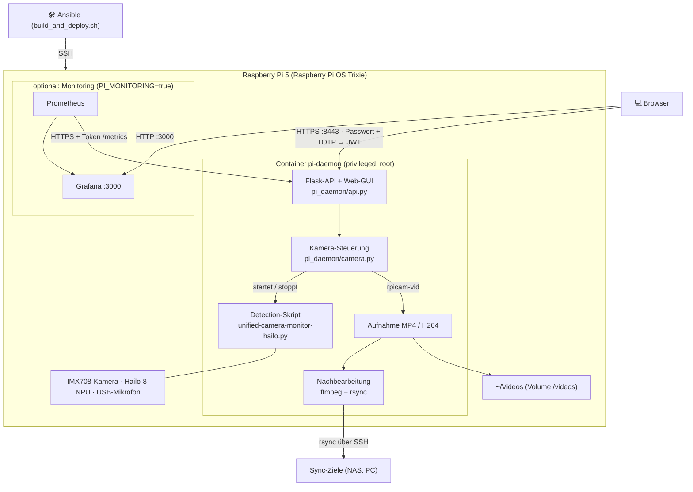
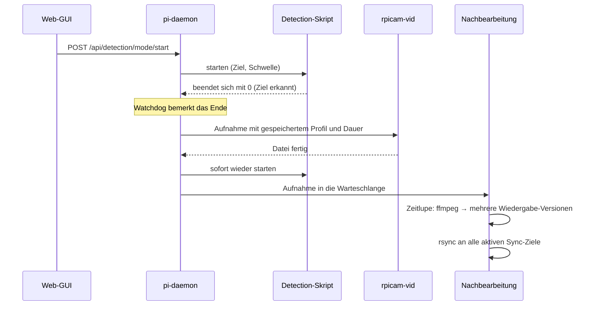

# 🏗️ Vogel-Kamera Architektur (v2.5)

## Überblick

Das System ist ein **Docker-Container auf dem Raspberry Pi 5**, der über eine HTTPS-Web-Oberfläche
bedient wird. Auf dem eigenen Rechner braucht es nur einen Browser – und für Installation und
Updates Ansible.



---

## Komponenten

### pi-daemon – der Container

`unified-monitor-client/pi_daemon_secure.py` ist nur der Startpunkt. Der Code liegt im Paket
`unified-monitor-client/pi_daemon/`:

| Modul | Aufgabe |
|---|---|
| `config` | Umgebungsvariablen, Logging (rotierend), Startprüfung |
| `runtime` | gemeinsamer Zustand (`state`) und Lock |
| `settings` | Erkennungsziel, Kamera-Einstellungen, Aufnahme-Profile – als JSON unter `/config` |
| `storage` | atomares Schreiben dieser JSON-Dateien |
| `camera` | Detection-Prozess, Aufnahme, Nachbearbeitung, Watchdog, Speicher-Aufräumung |
| `api` | Flask-App: Login, alle Routen, Auslieferung der Web-GUI |
| `hailo` | Hardware-Info und Temperatur der Hailo-NPU |
| `powerbank` | Anker-Powerbank per Bluetooth, Warnung und Shutdown |
| `monitoring` | Health-Cache für den Docker-Health-Check, Gotify-Meldungen |
| `metrics` | Prometheus-Endpunkt `/metrics` |
| `sync` | Sync-Ziele für die Übertragung |
| `main` | startet Hintergrund-Threads und den HTTPS-Server |

Der Container läuft **privileged als root**: Kamera-Reset per sysfs, Hailo-NPU und die
Kamera-Bibliotheken des Hosts brauchen vollen Gerätezugriff. `rpicam-vid`, `rpicam-hello` und
die zugehörigen Bibliotheken werden vom Host in den Container eingebunden.

**Hintergrund-Threads** (alle in `main.py` gestartet):

| Thread | Aufgabe |
|---|---|
| `detection-watchdog` | bemerkt das Ende des Detection-Skripts und startet Aufnahme oder Neustart |
| `post-process` | arbeitet fertige Aufnahmen ab: Zeitlupe konvertieren, dann übertragen |
| `auto-convert` | alle 3 Minuten: liegengebliebene H264 konvertieren, bei knappem Speicher aufräumen |
| `thread-monitor` | hält den Health-Cache aktuell |
| `hailo-temp` | liest alle 30 s die NPU-Temperatur |
| `powerbank` | liest die Powerbank aus (nur wenn eingerichtet) |

### Detection-Skript

`raspberry-pi-scripts/unified-camera-monitor-hailo.py` läuft als Subprozess im Container. Es
startet `rpicam-hello` mit dem Hailo-YOLOv8-Modell und liest dessen Ausgabe mit. Wird das
eingestellte Ziel (Vogel, Mensch, Hund, Katze oder alle vier) mit ausreichender Confidence
erkannt, beendet sich das Skript mit Rückgabewert 0 – das ist das Signal für die Aufnahme.

| Rückgabewert | Bedeutung | Reaktion des Daemons |
|---|---|---|
| 0 | Ziel erkannt | Aufnahme starten (wenn Detection-Modus aktiv) |
| 1 | Startfehler | kurz warten, neu starten |
| 2 | vom Daemon gestoppt | nichts |

`unified-camera-monitor-detect-only.py` ist die ältere CPU-YOLO-Variante ohne Hailo.

### Web-GUI

`unified-monitor-client/web/` – `index.html` (Aufbau und Online-Hilfe), `app.js` (Logik),
`app.css` (Gestaltung). Es gibt kein Inline-Skript; Knöpfe tragen `data-action="…"` und werden
in `app.js` einer Funktion zugeordnet. Dadurch erlaubt die Content-Security-Policy Skripte nur
aus der eigenen Quelle.

Die Oberfläche fragt `/api/status` alle 5 Sekunden ab, solange der Tab sichtbar ist. Die
Aufnahmeliste lädt sie nur neu, wenn sich `recordings_rev` im Status ändert.

### Ansible

`ansible/build_and_deploy.sh` baut das ARM64-Image auf dem eigenen Rechner, überträgt es auf den
Pi und richtet alles ein. Rollen: `docker`, `ssl`, `firewall`, `hardening`, `pi-daemon` und
optional `monitoring`. Details: [../ansible/README.md](../ansible/README.md).

### Monitoring (optional)

Mit `PI_MONITORING=true` startet die Rolle `monitoring` zwei weitere Container auf dem Pi:
Prometheus fragt alle 30 s `/metrics` ab, Grafana zeigt das Dashboard „Vogel-Kamera". Beide
laufen ohne besondere Rechte. Alternativ läuft derselbe Stack
auf einem anderen Rechner. Details: [../monitoring/README.md](../monitoring/README.md).

---

## Datenfluss: automatische Aufnahme



Wichtig: Kamera und Detection teilen sich den Sensor. Während `rpicam-vid` aufnimmt, ist die
Erkennung gestoppt. Konvertierung und Übertragung laufen dagegen getrennt davon – die Erkennung
startet, sobald die Aufnahme selbst fertig ist.

**Dateien:**

| Profil | Was entsteht |
|---|---|
| Normal (HD, 2K, 4K) | direkt eine MP4 mit Ton (`rpicam-vid --codec libav`) |
| Zeitlupe | rohes H264, danach vier MP4s: 10, 20, 30 fps und Originalgeschwindigkeit |
| Audio | WAV, 48 kHz |

Eine Datei, die gerade aufgenommen wird oder auf Nachbearbeitung wartet, fassen Auto-Convert und
Speicher-Aufräumung nicht an.

---

## Deployment-Ablauf

```
Eigener Rechner
    │
    ├─ docker buildx build --platform linux/arm64  →  vogel-pi:latest
    ├─ docker save | gzip  →  per SCP auf den Pi
    │
    └─ ansible-playbook (über SSH)
          ├─ --install: Docker, Zertifikat, Firewall, Härtung, Container, systemd-Dienst
          ├─ --update:  Image laden, app.env + docker-compose.yml erneuern, Dienst neu starten
          ├─ --hotpatch: nur pi_daemon/ und web/ in den laufenden Container kopieren
          └─ optional:  Rolle monitoring (Prometheus + Grafana)
```

Auf dem Pi:

| Pfad | Inhalt |
|---|---|
| `/opt/pi-daemon/` | `docker-compose.yml` des Daemons |
| `/etc/pi-daemon/` | `app.env` (Secrets), Zertifikat, Einstellungen als JSON, SSH-Keys der Sync-Ziele |
| `~/Videos/` | Aufnahmen |
| `/opt/pi-monitoring/` | Prometheus + Grafana (nur mit `PI_MONITORING=true`) |

---

## Sicherheitsmodell

| Aspekt | Maßnahme |
|--------|----------|
| Transport | HTTPS mit selbstsigniertem Zertifikat |
| Anmeldung | Passwort (bcrypt) + TOTP → JWT, 8 Stunden gültig |
| Browser | Content-Security-Policy (`script-src 'self'`), weitere Security-Header |
| Dateien | Zugriff nur innerhalb des Video-Verzeichnisses; Abspielen über kurzlebige Download-Tickets |
| Monitoring | `/metrics` nur mit eigenem, nur lesendem Token |
| Secrets | Ansible Vault; auf dem Pi in `/etc/pi-daemon/app.env` |
| Container | privileged als root – bewusst, siehe oben |

Vollständig mit bekannten Risiken: [SECURITY.md](SECURITY.md).

---

## Legacy-Architektur (< v2.2, archiviert)

Die alte Architektur mit SSH-basiertem Python-Client liegt in `legacy/`:

```
Lokaler PC
  └─ unified_monitor_client.py (Python)
       └─ SSH → Pi
            └─ unified-camera-monitor-auto.py (picamera2)
            └─ unified-camera-monitor-manual.py (rpicam-vid)
```
