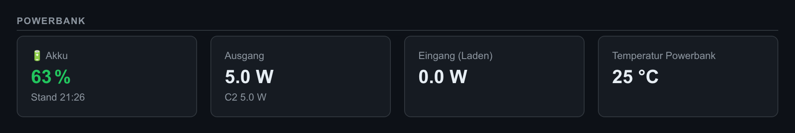

# 🔋 Release v2.4.0 - Powerbank-Überwachung

**Release Date:** 7. November 2026  
**Version:** 2.4.0  
**Vorgänger:** [v2.3.9](../v2.3.9/RELEASE_NOTES_v2.3.9.md)

---

## 📋 Übersicht

Die Kamera läuft an einer Powerbank – bisher ohne zu wissen, wie voll sie noch ist.
v2.4.0 liest eine **Anker Prime Power Bank (27K, 250W)** per Bluetooth aus, zeigt den
Akkustand im Webinterface, warnt rechtzeitig per Gotify und fährt den Raspberry Pi
sauber herunter, bevor der Strom ausfällt.

---

## 🔋 Powerbank im Webinterface

Neue Kartengruppe **„Powerbank“** (über „System“):



| Karte | Inhalt |
|-------|--------|
| 🔋 Akku | Akkustand in % (grün / orange ≤ 25 % / rot ≤ 10 %), Uhrzeit der letzten Messung |
| Ausgang | Gesamte Ausgangsleistung, darunter die aktiven Ports (z. B. `C2 5.0 W`) |
| Eingang (Laden) | Ladeleistung, wenn die Powerbank geladen wird |
| Temperatur Powerbank | Temperatur in °C |

Ist die Powerbank gerade nicht erreichbar, bleiben die letzten Werte stehen, mit dem
Hinweis „⚠️ nicht erreichbar“. Die Werte kommen auch per API: `/api/status` → `powerbank`.

### So funktioniert es

- Alle **60 Sekunden** verbindet sich der pi-daemon per Bluetooth LE, liest den Status
  und trennt sofort wieder – die Anker-App kann zwischendurch weiter zugreifen.
- Protokoll nach dem Reverse Engineering von
  [atc1441/Anker_Prime_BLE_hacking](https://github.com/atc1441/Anker_Prime_BLE_hacking):
  Handshake, AES-128-CBC mit festem Startschlüssel, danach Session-Key.
  **Kein Anker-Konto nötig**, an der Powerbank wird nichts verändert.
- Getestet mit Powerbank-Firmware v1.8.3.

---

## 🛡️ Akku-Schutz

| Akkustand | Aktion |
|-----------|--------|
| ≤ 10 % | Gotify-Warnung „Akku niedrig“ (einmal; erneut erst nach Anstieg auf ≥ 12 %) |
| ≤ 5 % | Detection und laufende Aufnahme werden beendet, Gotify-Meldung „Akku leer“, danach wird der Pi heruntergefahren |

Damit kein Messfehler den Pi abschaltet, wird erst heruntergefahren, wenn **zwei Messungen
in Folge** ≤ 5 % sind und die Powerbank **nicht gerade geladen** wird.
Das Herunterfahren läuft über systemd-logind auf dem Host.

Grenzwerte und Intervall stehen in [`ansible/group_vars/all/vars.yml`](../../ansible/group_vars/all/vars.yml)
(`pi_powerbank_*`).

---

## ⚙️ Einrichtung

1. MAC-Adresse der Powerbank auf dem Pi suchen:
   ```bash
   bluetoothctl --timeout 10 scan le; bluetoothctl devices | grep "Anker Prime"
   ```
2. In `ansible/.env` eintragen:
   ```bash
   PI_POWERBANK_MAC=00:7F:1D:xx:xx:xx
   ```
3. Update ausrollen (siehe unten).

Ohne `PI_POWERBANK_MAC` ist die Funktion aus und die Kartengruppe ausgeblendet.

> ℹ️ Jeder in Bluetooth-Reichweite kann die Powerbank auf diese Weise auslesen –
> das liegt an der Anker-Firmware, nicht an diesem Projekt.

### Technische Änderungen

- Neues Modul [`pi_daemon/powerbank.py`](../../unified-monitor-client/pi_daemon/powerbank.py)
- Container bindet `/run/dbus/system_bus_socket` ein (BlueZ für Bluetooth, logind für Shutdown)
- Neue Python-Abhängigkeiten: `bleak`, `cryptography`
- Neue Umgebungsvariablen: `PI_DAEMON_POWERBANK_MAC`, `…_INTERVAL`, `…_WARN_PERCENT`,
  `…_SHUTDOWN_PERCENT`
- 9 neue Tests (Statusauswertung mit echter Geräteantwort, Verschlüsselung,
  Warn-/Shutdown-Logik, API) – insgesamt 37

---

## 🔧 Bug Fixes

- **`--update` übernahm keine neuen Umgebungsvariablen:** `update.yml` schrieb
  `/opt/pi-daemon/.env`, der Container liest aber `/etc/pi-daemon/app.env`. Die Datei wurde
  nur bei der Erstinstallation geschrieben. Jetzt aktualisiert `update.yml` die richtige Datei.

---

## 🚀 Update

```bash
./ansible/build_and_deploy.sh --update
```

Das Image muss neu gebaut werden (neue Pakete, neuer Volume-Mount) – `--hotpatch` reicht
diesmal nicht. Danach Browser-Tab einmal neu laden.

---

## 📝 Commits

- `0e338ec` feat(pi-daemon): Anker-Powerbank per Bluetooth überwachen
